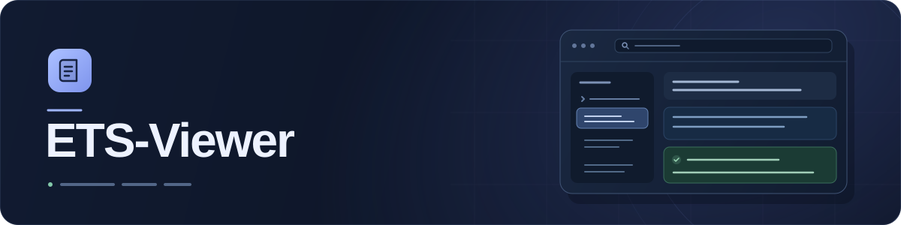

<p align="center">
  
</p>

<p align="center">
  <strong>浏览题目，查阅原有答案，全程离线。</strong><br>
  专注于阅读的桌面工具，让本地 ETS 题库更清晰易用。
</p>

<p align="center">
  <samp>Python 3.11+ · PySide6 · Windows · 离线运行</samp>
</p>

<p align="center">
  <a href="README.md">English</a> · <strong>简体中文</strong>
</p>

<p align="center">
  <a href="#快速开始">快速开始</a> ·
  <a href="#功能一览">功能一览</a> ·
  <a href="#日常使用">使用指南</a> ·
  <a href="#支持的数据格式">数据格式</a> ·
  <a href="#开发与测试">开发与测试</a>
</p>

---

ETS-Viewer 将本地 ETS 题库整理为可搜索的试卷、题目和参考答案。打开文件夹、选择题目，即可对照阅读原始内容与题库中已有的答案。

> **请准备自己的题库。** 本仓库仅包含查看器，不附带题库文件或答案数据集。

## 快速开始

**Windows 便携版：** 从 [Releases](https://github.com/Steven-w65/ETS-Viewer/releases) 下载 [ETS-Viewer-windows-x64.zip](https://github.com/Steven-w65/ETS-Viewer/releases/latest/download/ETS-Viewer-windows-x64.zip)，完整解压后打开 **ETS-Viewer.exe**。请保留可执行文件旁的 `_internal` 文件夹，无需安装 Python 或使用管理员权限。题库需要自行准备。

发布页面同时提供 `.zip.sha256` 校验文件。解压前可运行 `Get-FileHash .\ETS-Viewer-windows-x64.zip -Algorithm SHA256`，与文件中的 SHA-256 值核对。

**从源码运行：**

需要 **Python 3.11 或更新版本**，以及一份[格式受支持](#支持的数据格式)的本地题库。以下命令适用于 Windows PowerShell。

**1. 在项目文件夹中打开终端。** 请先下载或克隆本仓库。

**2. 安装依赖并启动。**

```powershell
python -m pip install -r requirements.txt
python main.py
```

**3. 选择题库。** 如果 `%APPDATA%\ETS` 存在，应用会自动加载；否则，点击 **Select Question Bank**（选择题库）。

也可以在启动时指定其他文件夹：

```powershell
python main.py "path\to\ETS"
```

请将 `path\to\ETS` 替换为题库的实际位置。如果 `APPDATA` 不可用，应用会使用当前用户主目录下的 `AppData\Roaming\ETS`。

应用界面目前使用英文，下文保留按钮原文并附上中文说明，便于对应操作。

## 功能一览

| | 你可以做什么 |
| --- | --- |
| **按试卷浏览** | 两级侧边栏先按修改日期显示试卷，进入后仅列出该试卷的题组及两行预览。 |
| **灵活搜索** | 通过试卷或题目 ID、关键词、原文、听力文本、选项、答案和来源路径查找内容，支持中文等 Unicode 文本。 |
| **舒适阅读** | 居中的阅读列、固定的小题导航、安全的本地题图，以及分开的题目与参考答案卡片。 |
| **自适应外观** | 支持跟随系统、浅色和深色，侧边栏可调宽度，窄窗口自动折叠为图标栏。 |
| **展开参考答案** | 默认显示首条已有答案，可分别展开每道小题的其他参考回答。 |
| **导出整份试卷** | 将完整试卷的题目及每道小题的首条已有答案保存为兼容 Windows 编辑器的 UTF-8 文本。 |
| **全程本地运行** | 无需账户、服务器或网络请求；扫描和浏览不会修改原始题库文件。 |

## 日常使用

1. **打开试卷。** **All Papers**（全部试卷）显示完整题库概览。点击试卷后，侧边栏仅列出该试卷的题组，并自动打开首个可见题组。返回 **All Papers** 不会重新扫描，同时恢复之前的全局搜索。
2. **查找题目。** 输入 ID、关键词、答案、翻译或来源路径。搜索不区分大小写，要求匹配所有输入词。全局搜索仅筛选左侧试卷，概览总数保持完整；进入试卷后仅在当前试卷中搜索。含匹配内容的公共材料和其他参考答案会自动展开。阅读工具栏的箭头仅在当前题组内逐项定位；目标位于手动收起的卡片时会重新展开。仅匹配元数据时会说明来源，不虚构高亮或数量。
3. **阅读参考答案。** 每道小题的首条参考答案单独显示，选择题选项均使用中性样式。**Show N more answers** 将其余原始参考回答按顺序显示在同一卡片内，各小题独立展开，顶部和底部均可收起。公共材料每次进入题组时默认折叠；Qn 按钮在同一文档内滚动。调整窗口、侧边栏或主题会保留阅读状态。
4. **调整工作区。** 拖动分隔条调整侧边栏宽度，或使用折叠按钮。窄窗口自动使用图标栏，需要列表或搜索时仍可展开，扩大窗口后恢复手动偏好。通过 **Settings → Appearance → System / Light / Dark** 切换外观，偏好保存在本地；System 会跟随 Windows 应用外观。
5. **导出试卷。** 点击阅读区右上角 **Export Paper**，选择 `.txt` 保存位置。成功后显示短暂通知，失败时显示目标路径及实际原因。

**导出规则：** 文件包含**所选试卷的全部题目**，包括被当前搜索隐藏的题目；每道小题**仅导出首条已有答案**。缺失答案仍标记为 `Answer not found`。文件使用带 BOM 的 UTF-8 编码，通过原子保存避免写入中断损坏已有导出，并防止覆盖原始题库文件。

详情栏显示试卷、题组、题型及简短日期，悬停可查看完整来源路径与精确的本地修改时间。题库未提供描述性标题时，使用原始文件夹 ID 作为试卷名称。侧边栏底部始终提供 **Change Bank**（更换题库），折叠时显示文件夹图标。

## 支持的数据格式

查看器支持以下 ETS collector 数据结构：

| 数据结构 | 显示内容 | 答案来源 |
| --- | --- | --- |
| `collector.choose` | 公共材料、题干、听力文本和带标签的选项 | 明确存储的选择题答案；必要时使用对应元数据补充 |
| `collector.dialogue` | 对话材料和各小题题干 | 明确存储的答案及关联的参考回答 |
| `collector.picture` | 主题、题干、原始本地图片和已有解析 | 已存储的参考回答 |
| `collector.word` | 单词或句子内容、翻译及解析 | 已检查的数据中没有答案字段 |
| `collector.read` | 阅读内容、翻译及解析 | 已检查的数据中没有答案字段 |

**答案来自题库原始数据。** 缺失答案显示为 `Answer not found`（未找到答案）。应用不会将题干、阅读文章、语音评测字段或评分关键词拼成答案。

<details>
<summary><strong>文件夹结构与记录映射</strong></summary>

典型题库按试卷文件夹存放题目记录与本地资源：

```text
ETS/
└── <paper-id>/
    └── content_<question-id>/
        ├── content.json
        ├── content2.json
        ├── info.json
        └── material/
```

- 优先读取 `content.json`。当它缺失、损坏或结构不完整时，扫描器会依次尝试 `content2.json` 和 `info.json` 中受支持的选择题元数据。
- 同一题目文件夹内的备用副本不会重复计数；不同来源文件夹中的记录即使 ID 相同，也会分别保留。
- 选择题元数据通过 `stid`、`xth` 对应 `info.stid`、`xt_xh`。主记录中明确存储的答案优先。
- 对话参考答案取自同一小题的 `answer`、`std[].value` 和 `ref[].value`；图片题取自 `std[].value` 和 `ref[].value`。
- 显示时会移除开头的 `ets_thN` 模板标记，其他原始题目与参考文本保持原样。
- 符合已支持结构的 JSON 记录也可使用其他文件名或扩展名；字典、模板和媒体资源不会出现在题目列表中。

</details>

<details>
<summary><strong>功能范围与文件限制</strong></summary>

- 未知 collector 结构、SQLite/XML 数据库或文件、压缩包、加密数据及无法访问的文件会记录到 **scan notes**（扫描说明）中，其他可读题目仍可加载。
- 不含题目 ID 的独立 `[choice]` 答案缓存会被记录，不会猜测其对应题目。
- 不解析超过 **32 MiB** 的 JSON 文件，不遍历符号链接或目录联接。
- 题图必须位于所选题库内，且不超过 **16 MiB** 和 **4,000 万像素**。原始内容中的标记无法加载脚本或网络资源。
- 应用支持题目浏览、本地题图、已有答案和文本导出；不提供音视频播放、录音、评分或学习管理功能。
- 扫描在后台运行；打开其他文件夹会取消上一次扫描，关闭应用时会等待扫描线程安全结束。

</details>

## 常见问题

| 遇到的情况 | 处理方式 |
| --- | --- |
| **No exams found**（未找到试卷） | 请选择包含受支持题目记录的文件夹，可以是题库根目录、单份试卷，或某个 `content_<id>` 文件夹。 |
| **scan notes / Scan failed** | 点击状态栏的 **View details**，在可滚动的对话框中查看真实来源路径及具体原因。 |
| **Answer not found**（未找到答案） | 原始记录没有可用的已有答案，查看器会如实保留这一状态。 |
| **Image unavailable**（图片不可用） | 检查原始图片是否位于题目文件夹或其 `material/` 目录中，并确认未超过图片限制。 |
| **Export failed**（导出失败） | 请选择有写入权限的位置。日常使用请从自己的终端启动应用，开发沙箱可能限制向其他文件夹保存；无需管理员权限。 |

## 开发与测试

应用使用 Python 标准库和 PySide6，解析、扫描、导出与界面渲染各自独立：

```text
ETS-Viewer/
├── main.py              # 应用入口
├── requirements.txt     # PySide6 依赖
├── core/                # 解析、扫描与答案导出
├── ui/                  # 主窗口、安全渲染与样式
├── tests/               # 单元测试与集成测试
├── docs/assets/         # README 视觉素材
├── README.md            # English
└── README.zh-CN.md       # 简体中文
```

在项目根目录运行测试：

```powershell
python -m unittest discover -v
```

依赖题库数据的测试使用开发时的原始参考题库，默认从当前用户的 ETS 文件夹读取；配置的题库文件夹不存在时会跳过这些测试。任意其他题库不一定包含测试所需的记录。本项目不分发测试题库数据。

如需明确指定参考题库：

```powershell
$env:ETS_TEST_BANK = 'path\to\ETS'
python -m unittest discover -v
```

界面集成测试使用 Qt 离屏平台和真实事件循环。导航、阅读、主题和启动的合成数据测试无需私有题库；依赖原始题库的测试仍保留数据检查，并在题库缺失时跳过。无需安装额外测试包。

### 自动回归检查

[Regression checks 工作流](https://github.com/Steven-w65/ETS-Viewer/actions/workflows/regression.yml) 在推送和拉取请求时自动运行。Windows 检查覆盖 Python 3.11 与 Qt 6.8、Python 3.14 与受支持的 Qt 版本，以及 125%/150% 显示缩放。解析、扫描、导出、安全和界面测试使用合成数据，不需要私有题库；依赖原始题库的测试会在数据缺失时跳过。各任务保留测试日志。

### 构建 Windows 便携版

在 Windows 上使用 64 位 Python。构建依赖与查看器的运行依赖分开管理：

```powershell
python -m pip install -r requirements-build.txt
python tools/build_portable.py
python tools/smoke_portable.py dist/ETS-Viewer-windows-x64.zip
```

构建结果为 `dist/ETS-Viewer-windows-x64.zip` 及对应的 SHA-256 校验文件，包含 Python/Qt 运行环境、图片插件、主题模板及依赖自带的许可证元数据，不包含题库或测试文件。`BUILD-INFO.txt` 记录源码提交和打包版本。

冒烟测试会将 ZIP 解压到含空格及 Unicode 字符的路径，移除 `PATH` 中的 Python，以合成题库启动打包程序，检查原生窗口并请求正常退出。

[Portable Windows release 工作流](https://github.com/Steven-w65/ETS-Viewer/actions/workflows/portable-windows.yml) 支持手动运行并下载经过测试的构建产物。推送新的 `vMAJOR.MINOR.PATCH` 标签后，工作流会运行回归检查、构建并验证便携版，然后将 ZIP 和校验文件发布到 GitHub Releases。
